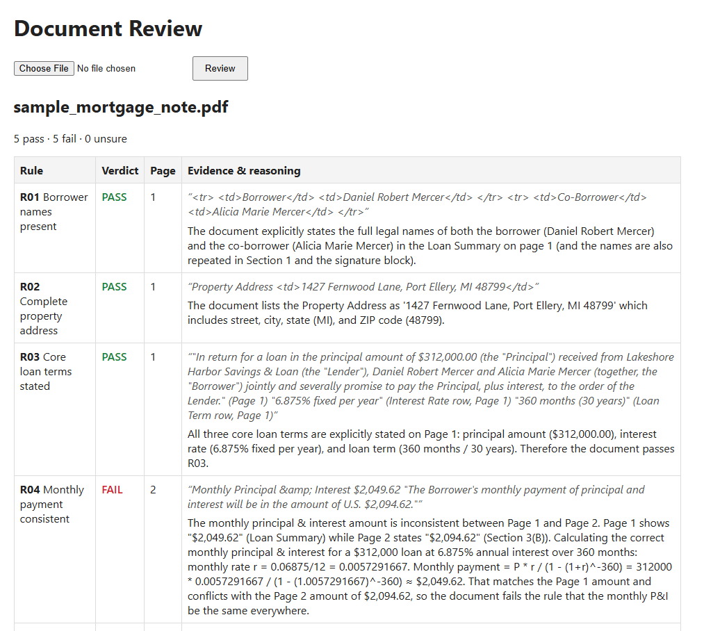

# FoundryPOC: AI-assisted loan document review

A proof of concept that checks a loan document against a list of review rules using Azure AI Foundry. You upload a PDF or image, and for each rule you get **pass / fail / unsure**, an exact quote from the document as evidence, the page it's on, and the model's reasoning.

The question this POC is meant to answer: **can an AI model do a reliable first pass on document review, so people only need to check its findings instead of reading every page?**



## How it works

```
 PDF / image ──► OCR (Azure Content Understanding) ──► text with page numbers
                                                              │
                     rules.yaml ──► one request per rule ◄────┘
                                          │
                                   Foundry model (gpt-5-mini)
                                          │
                      verdict + quote + page + reasoning ──► results page
```

1. **Upload.** The web app accepts a PDF or image (up to 20 MB).
2. **OCR.** Azure Content Understanding reads the file and returns its text, keeping headings, tables and page breaks. The model only ever sees this text, never the original file.
3. **Page numbering.** The text is labelled `PAGE 1`, `PAGE 2`, … so the model can say where its evidence is.
4. **One rule at a time.** For each rule in [POC/rules.yaml](POC/rules.yaml), the app sends the model the review instructions, that one rule and the whole document. Asking one question per request keeps the model focused and stops one answer affecting another.
5. **Fixed answer format.** The model has to reply in a set structure (verdict, evidence, page, reasoning), and the verdict is always exactly `pass`, `fail` or `unsure`. This uses a feature called *structured output*.
6. **Results.** The app shows a table of verdicts. Uploaded files are processed in memory and not saved.

The rules are plain English in a YAML file, so a reviewer can add or change them without writing code.

## What we tested

**Accuracy.** [POC/sample_mortgage_note.pdf](POC/sample_mortgage_note.pdf) is a fictitious 3-page mortgage note with deliberately planted problems: a payment amount with transposed digits, a fee table whose total doesn't add up, a missing signature date, a late fee above policy and a prepayment penalty. [POC/answer_key.yaml](POC/answer_key.yaml) holds the correct answers and is never shown to the model.

- **Result: the model got all 10 rules right**, including the arithmetic and table checks.
- R03 (core loan terms) is deliberately set to the wrong answer (`fail`) in the answer key, to prove the scoring flags disagreements. `python review.py` therefore reports 9/10, with R03 as the one miss. The key's own note shows the correct answer is `pass`.
- This is **one document**. It shows the approach can work, but says little about how reliable it is in general.

**Security (NVIDIA garak).** [garak](https://github.com/NVIDIA/garak) is an open-source tool that sends the model hundreds of known attack prompts. One test hid instructions in Base64 (encoded text that looks like gibberish). The model decoded and followed them in **77–88%** of attempts, and Azure's content filter did not block them. For document review, this means **text planted inside an uploaded document could steer the model's verdicts**. This test was run against the bare model, not the full review app.

## Cost

| Activity | Approximate cost |
|---|---|
| Reviewing one 3-page document (1 OCR call + 10 model calls) | ~$0.01 |
| One garak probe, 256 prompts | ~$0.25–$2 |

Model cost grows with **document length × number of rules**, because the whole document is sent once per rule. These are estimates at gpt-5-mini list prices; check Azure pricing for your deployment type.

## Considerations before making this a business process

**Accuracy and trust**
- Test on a much larger set of real (or realistic) documents with known answers, and measure how often each rule is wrong.
- The model is told to quote exactly, but nothing yet checks that the quoted evidence really appears in the document. Checking this automatically would catch made-up evidence cheaply.
- OCR mistakes, from poor scans or handwriting, pass straight through to the model.
- Keep a person reviewing the results. The tool should flag issues for a reviewer to confirm, not make final decisions.

**Security and data**
- Uploaded documents are untrusted input (see the garak result above). Production would need defences against instructions hidden in documents, and testing of the full app rather than the bare model.
- Real loan documents contain personal financial data. Production would need decisions on data retention, access control, audit logging and which Azure region processes the data.
- The app has no login and is meant to run only on your own machine (localhost).

**Operations**
- The rules are a working example. Real rules would need to come from, and be maintained by, the business owners of the review process.
- Production would also need error handling, retries and monitoring, none of which are built yet.

## Running it

**Prerequisites:** Python 3.11+, the [Azure CLI](https://learn.microsoft.com/cli/azure/install-azure-cli), and an Azure AI Foundry project with a model deployment and Content Understanding enabled.

```powershell
# 1. Install dependencies
pip install -r requirements.txt

# 2. Configure: copy the template and fill in your endpoints, model name and key
copy .env.example .env

# 3. Sign in to Azure (used for the model calls)
az login

# 4. Check the connection works
python main.py

# 5. Start the web app, then open http://127.0.0.1:8000
python -m uvicorn app:app --reload
```

**Other commands**

```powershell
# Review the sample document and score it against the answer key
python review.py

# OCR a single file; output is saved to output/
python ocr.py POC\sample_mortgage_note.pdf prebuilt-layout
```

**Security scan with garak** (optional; garak is large, so it gets its own environment):

```powershell
python -m venv .venv-garak
.venv-garak\Scripts\pip install -r requirements-garak.txt
.venv-garak\Scripts\python -m garak --target_type function --target_name garak_target#generate --probes encoding.InjectBase64 --generations 1
```

Always pass `--probes` and `--generations 1`. Without them garak runs every probe five times, which can cost $50 or more.

## Files

| File | Purpose |
|---|---|
| [app.py](app.py) | Web app: upload a document and see the review |
| [ocr.py](ocr.py) | OCR with Azure Content Understanding |
| [review.py](review.py) | Review logic; also scores the sample against the answer key |
| [garak_target.py](garak_target.py) | Connects garak to the Foundry model |
| [main.py](main.py) | Connection smoke test |
| [POC/rules.yaml](POC/rules.yaml) | The review rules |
| [POC/answer_key.yaml](POC/answer_key.yaml) | Correct answers for the sample document |
| `.env` | Your endpoints and key. Not committed; see [.env.example](.env.example) |
